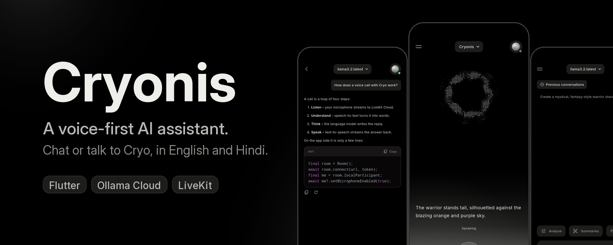
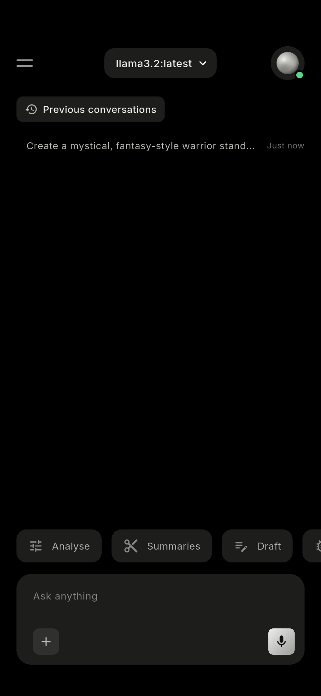
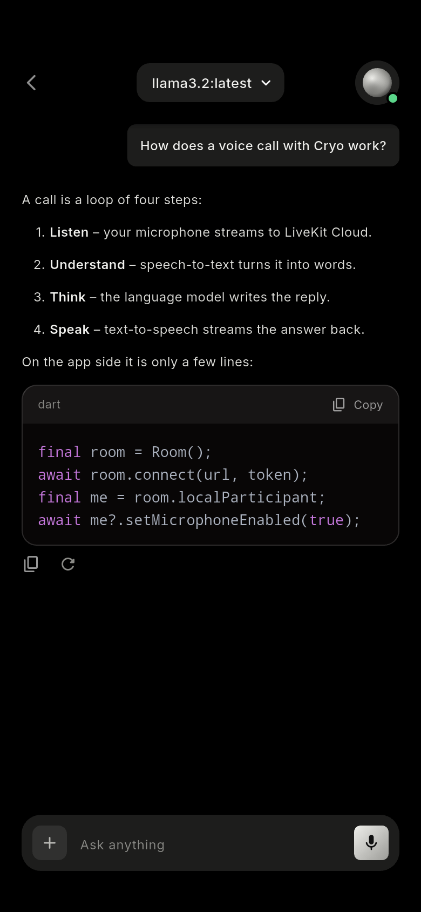
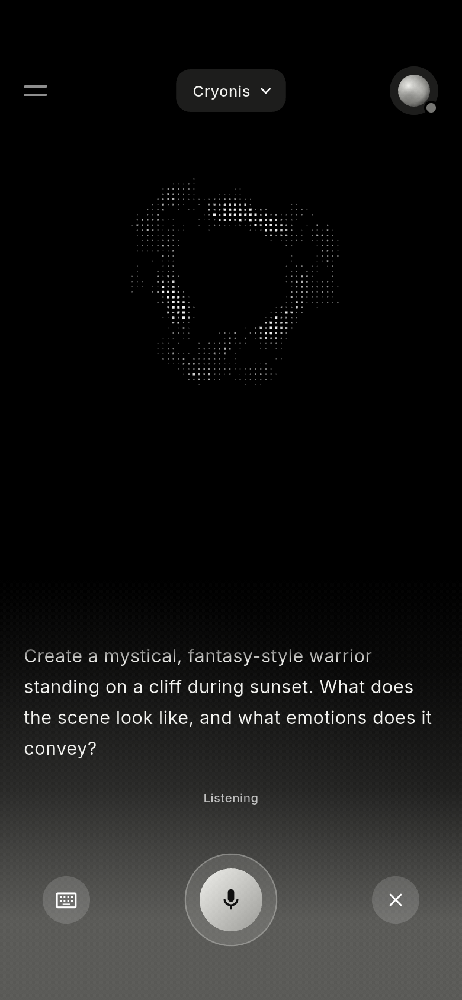
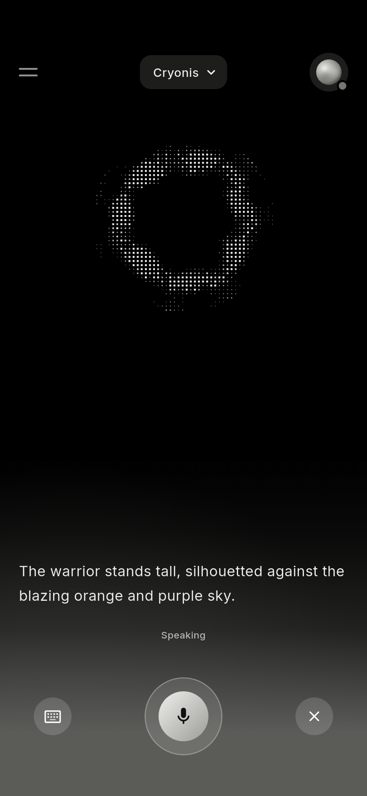
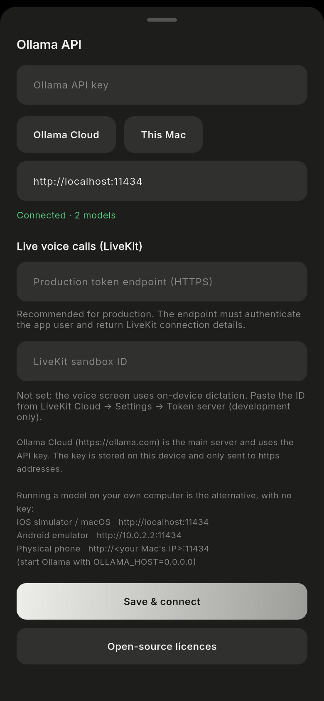
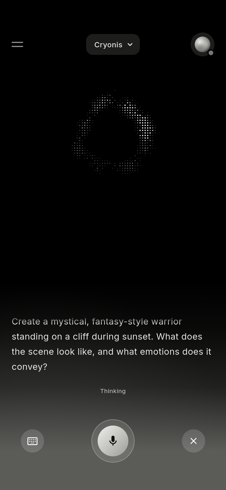
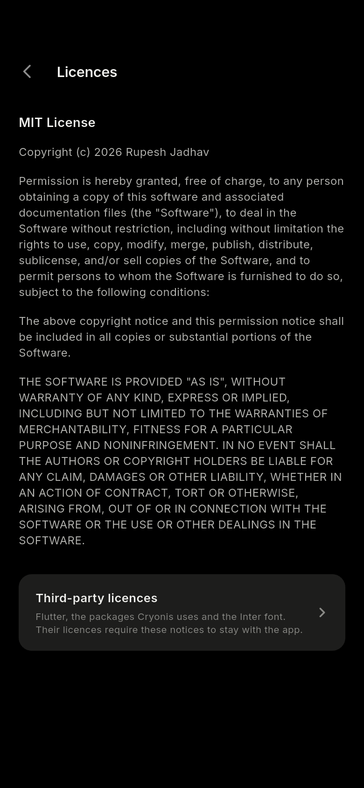
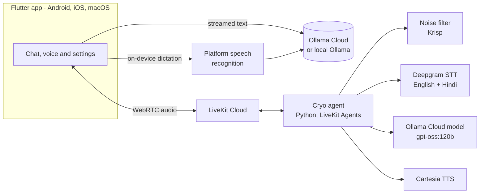

<p align="center">
  
</p>

<p align="center">
  <a href="LICENSE"></a>
  
  
  
  
  
</p>

<p align="center">
  <b>Chat with an AI, or just talk to it. In English and Hindi.</b><br>
  Cryonis is a Flutter assistant for Android, iOS and macOS with streaming text chat through Ollama and a live voice agent called <i>Cryo</i>.
</p>

<table align="center">
  <tr>
    <td align="center"><br><sub>Home</sub></td>
    <td align="center"><br><sub>Chat</sub></td>
    <td align="center"><br><sub>Voice: listening</sub></td>
    <td align="center"><br><sub>Voice: Cryo speaking</sub></td>
    <td align="center"><br><sub>Settings</sub></td>
  </tr>
</table>

<p align="center">
  <sub>Rendered from the app's real widgets with sample text, with no network and no key. Regenerate them with the steps in <a href="tool/readme_images.py"><code>tool/readme_images.py</code></a>.</sub>
</p>

<details>
<summary>More screens</summary>

<table align="center">
  <tr>
    <td align="center"><br><sub>Voice: thinking</sub></td>
    <td align="center"><br><sub>Licences</sub></td>
  </tr>
</table>

</details>

## Highlights

| | |
|---|---|
| **Streaming chat** | Ollama text chat with Markdown, syntax-highlighted code, retry, regenerate and stop. Up to four images per prompt for vision models. |
| **Talk to Cryo** | A two-way voice call over WebRTC: Deepgram speech recognition, an Ollama Cloud model for the answer, and Cartesia speech. You can interrupt it, and a background-noise filter cleans your microphone. |
| **English and Hindi** | Cryo answers in the language you speak, writes Hindi in Devanagari and follows mixed Hindi/English sentences. |
| **Works without a voice server** | On-device dictation takes over until a LiveKit project is configured. |
| **Free-tier friendly** | The model picker lists Ollama Cloud's free models. A local Ollama server works too. |
| **Private by default** | API keys live in the Keychain or Keystore, are only sent to `https` addresses, and no account is needed. |
| **Designed, not themed** | A black canvas, charcoal surfaces, a silver accent, Inter type, and a ring of dots that moves differently while Cryo listens, hears, thinks and speaks ([design notes](UI_SPEC.md)). |
| **Tested** | 104 Flutter tests and 40 Python agent tests, strict static analysis, and an in-app licences screen. |

## How it works



## Quick start

```bash
git clone <repository-url> cryonis && cd cryonis
flutter pub get
printf "const ollamaApiKey = '';\nconst livekitSandboxId = '';\n" > lib/secrets.dart
flutter run -d macos
```

Then open the settings sheet (the menu icon), choose **Ollama Cloud**, paste an [Ollama API key](https://ollama.com/settings/keys) and pick a model. Voice calls need a LiveKit project and the deployed agent: see [Set up live voice](#set-up-live-voice). Everything else on this page is reference material.

## Project status

- Text chat, Markdown and code rendering, image prompts, model selection, error handling, retry, regenerate and stop are implemented.
- One conversation is saved across restarts; the home screen lists it under **Previous conversations** and resumes it.
- **Voice:** on-device dictation and the live LiveKit call screen, with recoverable call retries. The ring animates per phase of the agent's loop: listening (breathing, outward ripples), your words arriving (inward ripples), thinking (an orbiting arc) and speaking (ripples driven by Cryo's voice).
- **Voice agent (deployed on LiveKit Cloud):** [agent/](agent/README.md) is the single source of truth. It supports English and Hindi, `gpt-oss:120b`, the Hindi/Hinglish Cartesia voice setting, background-noise filtering, table-aware speech cleanup, per-turn latency and interruption logging, and a spoken greeting. Contributors deploy it to their own LiveKit Cloud project using the public example configuration.
- Ollama API keys use secure platform storage; older plain-text preferences are migrated automatically.
- 104 Flutter tests and 40 Python agent tests pass; macOS and Android debug builds are supported. The app has been run on an Android phone (A142, Android 16): a call started from it reached the deployed agent and speech was transcribed (2 Nov 2026).
- **Not verified:** how a live call sounds to a real listener (audio quality, interrupting it, reconnecting) and a signed release build.
- If a call hangs on "Connecting…", check the agent still exists: `lk agent list` (on 2 Nov it had vanished from the project and was re-created).
- The LiveKit sandbox token flow is development-only. Use an authenticated token endpoint before production.

## Documentation

| File | What is in it |
|---|---|
| [PROJECT_STATUS.md](PROJECT_STATUS.md) | The verified checklist and remaining external work |
| [PROJECT_IMPROVEMENTS.md](PROJECT_IMPROVEMENTS.md) | The prioritized engineering backlog and open-source launch checklist |
| [PROJECT_CONTEXT.md](PROJECT_CONTEXT.md) | Architectural decisions and project history |
| [UI_SPEC.md](UI_SPEC.md) | Design analysis: colours, type, motion timeline, ring phases |
| [BUILD_GUIDE.md](BUILD_GUIDE.md) | A step-by-step implementation walkthrough |
| [agent/README.md](agent/README.md) | The voice agent: models, languages, noise and interruption results, deployment |

## Project layout

```text
lib/screens/        Home, chat, dictation, live-call and licences screens
lib/services/       Ollama, speech recognition, LiveKit clients and licence registration
lib/state/          Conversation, connection, model, and settings state
lib/widgets/        Header, input card, Markdown/code, and the voice visuals
                    (dot_ring, glow_backdrop, voice_widgets)
lib/utils/          Small helpers (relative time for the conversation list)
assets/fonts/       Inter (SIL Open Font License)
docs/               README images (screenshots, banner, social preview)
test/               Flutter unit and widget tests
integration_test/   Real Ollama Cloud chat test and a screen-render preview
tool/               The script that builds the README images
agent/              The deployed Python voice agent, tests, Dockerfile, deployment config, and scripted-call tool
```

## Requirements

- Flutter 3.47.5 or another compatible stable release with Dart 3.13+
- Xcode for macOS/iOS builds
- Android Studio or Android command-line tools with JDK 17 for Android builds
- An Ollama Cloud API key, or a reachable local Ollama server
- Optional for live voice: a LiveKit Cloud project and the LiveKit CLI
- Optional for agent development: Python 3.11–3.14 and `uv`

## Set up the Flutter app

Install dependencies:

```bash
flutter pub get
```

Create the ignored local secrets file if it is absent:

```dart
// lib/secrets.dart
const ollamaApiKey = '';
const livekitSandboxId = '';
```

You can leave both values empty and enter them later in the in-app settings. In-app Ollama keys are stored with the platform's secure credential storage. Do not commit real keys; a key compiled into an app can be extracted and is unsuitable for a public release.

Run a desktop build:

```bash
flutter run -d macos
```

Other common targets:

```bash
flutter run -d android
flutter run -d ios
```

### Use Ollama Cloud

1. Create an API key in Ollama Cloud.
2. Open Cryonis settings.
3. Select `https://ollama.com` and enter the key.
4. Save and choose an available model.

### Use local Ollama

Start Ollama and pull a model:

```bash
ollama serve
ollama pull llama3.2
```

Use the correct address in Cryonis:

| Target | Ollama address |
|---|---|
| macOS or iOS simulator | `http://localhost:11434` |
| Android emulator | `http://10.0.2.2:11434` |
| Physical phone | `http://<computer-lan-ip>:11434` |

For a physical phone, expose Ollama only on a trusted network and start it with the required host binding, such as `OLLAMA_HOST=0.0.0.0`.

## Set up live voice

The app uses on-device dictation until a LiveKit sandbox ID (or a production token endpoint) is configured.

For a development LiveKit call:

1. Create a LiveKit Cloud project.
2. Follow [agent/README.md](agent/README.md) to authenticate the CLI and deploy the Python agent.
3. Enable the LiveKit development token server and copy its sandbox ID.
4. Paste that ID into the Cryonis settings sheet.
5. Open voice mode and verify microphone permission, speaker output, transcripts, interruption, and hand-off to chat. Both the keyboard and X controls end voice mode and continue the completed transcript in text chat.

The sandbox token server is intentionally not a production authentication system. For production, enter an application-owned HTTPS token endpoint in the settings sheet; it takes precedence over the sandbox ID. That endpoint must authenticate the user and return short-lived LiveKit connection details. LiveKit API secrets must never be placed in Flutter code.

### Voice agent settings

The deployed agent (`agent/`) reads these from its environment, so you can change them as agent secrets without rebuilding:

| Setting | Default | Meaning |
|---|---|---|
| `OLLAMA_MODEL` | `gpt-oss:120b` | the model that answers (keep it on Ollama's free list; `gemma4:31b` takes ~10 s to start) |
| `STT_LANGUAGE` | `multi` | Deepgram nova-3 speech recognition language; handles English, Hindi, and mixes |
| `TTS_LANGUAGE` | `hi` | the voice's language setting: `hi` speaks Hindi / Hinglish, `en` speaks English |
| `TTS_VOICE` | the voice used so far | any Cartesia voice ID |
| `NOISE_CANCELLATION` | `nc` | microphone filter on LiveKit Cloud: `nc` (free background-noise filter), `off`, or `bvc` (also removes other voices; billed extra, untested) |
| `INTERRUPTION_MIN_WORDS` | `0` | recognised words required before the caller interrupts the agent |
| `AGENT_NAME` | `cryonis-agent` | the name the app asks for; leave it alone when deployed |

```bash
cd agent
lk agent update-secrets --secrets TTS_LANGUAGE=en   # change one setting
lk agent secrets                                    # list names (values stay hidden)
lk agent logs                                       # the first line of each call shows the settings in use
lk agent deploy                                     # ship a code change
```

Never add `--overwrite` to `update-secrets`: it asks to remove every other secret, including the Ollama key.

To test the deployed agent without a microphone, `agent/tools/call_agent.py` joins a real call by agent name (as the app does), speaks
questions with macOS `say` and prints what the agent heard and answered:

```bash
cd agent
uv run --with numpy python tools/call_agent.py <token-server-id> tools/questions.json
```

It spends a little of the free call credit per run, so keep the question list short.

## Run on an Android phone

1. Plug the phone in with **USB debugging** on (Developer options), or use **Wireless debugging** on the same Wi-Fi; keep it unlocked and
   tap Allow on the debugging prompt.
2. List it, then run (quote the ID: wireless IDs can contain spaces and brackets):

   ```bash
   flutter devices
   flutter run -d "<device id from the list>"
   ```

3. A wireless connection can drop when the phone changes network; run `adb devices -l` and re-enable Wireless debugging if it is empty.
   Uninstalling the app (`adb -s "<id>" uninstall com.rupeshjadhav.cryonis`) also wipes its saved chats and settings.

## Attach images and resume chats

- The attach control accepts PNG, JPG/JPEG, and WebP files.
- A prompt can contain up to four images, with a 5 MB limit per image.
- Images are encoded for Ollama's `images` message field, so select a vision-capable model.
- Completed and partial conversations, including image prompts, are saved locally.
- Use **Previous conversations** on the home screen to resume, or start a new prompt to clear the old conversation.

## Test and build

Run the checks that do not need external accounts:

```bash
dart analyze .
flutter test

cd agent
uv sync --locked
uv run pytest -q            # the deployed agent; this is what CI runs
```

Build debug artifacts:

```bash
flutter build macos --debug
flutter build apk --debug
```

The real-network integration test consumes Ollama quota and requires a valid local secret:

```bash
flutter test integration_test/native_chat_test.dart -d macos
```

To look at every screen without a phone or a call, render them inside the real macOS app (no network, no key); it prints the paths of
the PNGs it writes. The same PNGs feed the README images ([`tool/readme_images.py`](tool/readme_images.py)):

```bash
flutter test integration_test/voice_ui_preview_test.dart -d macos
```

## Security and release notes

- `lib/secrets.dart` and `agent/.env.local` are ignored. Keep them out of source control.
- Report vulnerabilities privately by following [SECURITY.md](SECURITY.md). Do not open a public security issue.
- In-app API keys use Keychain/Keystore-backed secure storage. A backend-owned provider key is still preferable when distributing the app to untrusted clients.
- The bundle/application ID is `com.rupeshjadhav.cryonis`. Configure real Android and Apple signing credentials before distribution; `android/key.properties.example` documents the Android values.
- Web is not a supported Ollama Cloud target because the browser cannot call the current endpoint directly under its CORS policy.
- VoiceStudio support in the agent is an optional wiring path and has not been verified against a live VoiceStudio server.

## Continuous integration

GitHub Actions under `.github/workflows/ci.yml` runs static analysis, Flutter tests, Python agent tests, and Android/macOS debug builds without requiring provider secrets. `.github/workflows/security.yml` checks the complete fetched Git history with Gitleaks on every push and pull request. `.github/workflows/dependency-review.yml` blocks a pull request that adds a dependency with a high or critical advisory or an AGPL/GPL licence, and `.github/dependabot.yml` proposes weekly updates for GitHub Actions, Dart packages and the agent's Python lock. All workflows use read-only repository permissions and pin every third-party action to a reviewed commit SHA.

> **Switched off on the maintainer's repository.** Actions are currently disabled in its Settings → Actions → General, so none of these workflows run there until they are turned back on. A fork or a new repository runs them as soon as Actions is enabled.

Contributors with Gitleaks installed can scan committed history before pushing:

```bash
gitleaks git . --redact
```

Signed production builds still need platform signing credentials. Real Ollama and LiveKit integration tests remain deliberate manual checks.

## Contributing

Cryonis welcomes contributions from everyone. All changes must be proposed through a pull request; direct pushes to `main` are not allowed, and only maintainers may merge after the required review and CI checks pass.

Read [CONTRIBUTING.md](CONTRIBUTING.md) before starting and [GOVERNANCE.md](GOVERNANCE.md) for contributor, reviewer and maintainer responsibilities. Participation is governed by the [Code of Conduct](CODE_OF_CONDUCT.md), support requests follow [SUPPORT.md](SUPPORT.md), and vulnerabilities must be reported privately under [SECURITY.md](SECURITY.md). GitHub owners must enable the rules in [.github/BRANCH_PROTECTION.md](.github/BRANCH_PROTECTION.md) after the public remote is created—the policy files do not enforce branch protection by themselves.

## Licence

Cryonis is open-source software licensed under the [MIT License](LICENSE). The bundled Inter font remains licensed separately under the [SIL Open Font License](assets/fonts/Inter-OFL.txt). In the app, the **Open-source licences** button at the bottom of the server-settings sheet (the menu icon in the header) shows this MIT licence first, with the licences of Flutter, its packages and the Inter font one tap behind it.

The interface layout, colours and motion follow the Dribbble shot [Lumix – AI Platform Mobile App](https://dribbble.com/shots/26513278-Lumix-AI-Platform-Mobile-App) by Barly Design (no brand assets are used); see [UI_SPEC.md](UI_SPEC.md) for the analysis and [PROJECT_IMPROVEMENTS.md](PROJECT_IMPROVEMENTS.md) for the open question about permission.
